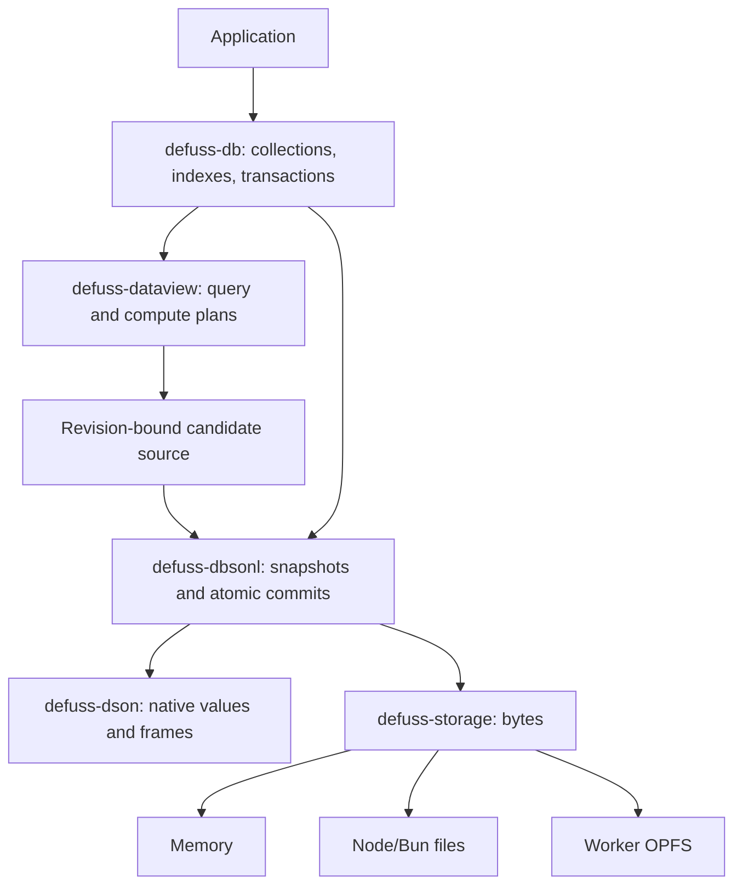

# Architecture

The database is a model layer over the existing byte, record and query packages. It does not implement another serializer, storage transaction protocol or filter/aggregation engine.

## Storage model and consistency

One logical database is one DBSONL store. Separate files per collection would make multi-collection atomicity require another commit protocol. Sharing a store lets the existing commit cover documents, uniqueness claims and metadata together. The trade-off is shared commit serialization and conservative phantom conflicts after a transaction scans.

Keys partition this store:

| Prefix | Meaning |
| --- | --- |
| `!defuss-db-format` | `{ format: 'defuss-db', version: 5, id: UUID }` |
| `s:<collection>` | Versioned schema with equality, ordered and search-index definitions; written only by DDL |
| `p:<collection>:<index>:<typed-id>` | Projected search text/vector input |
| `g:<collection>:<index>` | Search generation UUID, document count and estimated input bytes |
| `d:<collection>:<typed-id>` | DSON document |
| `r:<collection>` | Constant 1 whose DBSONL record revision identifies the last committed collection change |
| `o:<collection>:<index>:<ordered-tuple><typed-id>` | Maps the ordered tuple, with a deterministic tiebreaker, to the typed document ID |
| `u:<collection>:<index>:<tuple>!` | Maps the unique tuple to the typed document ID |
| `i:<collection>:<index>:<tuple>!<typed-id>` | Maps the nonunique tuple plus ID to the typed document ID |

A collection exists once its `r:` marker exists; every document write touches it with a blind write. Its schema is stored only by DDL (indexes, search indexes, history activation); until then readers use the implicit default schema. Writing a default schema on the first document write would make every first writer read and then write `s:<collection>`, so concurrent first writes to a new collection would conflict although they touch different documents. `collections()`, `verify()` and export enumerate the union of `r:` markers and stored schemas.

Collection/index names have a restricted ASCII grammar, making prefix ranges unambiguous. String IDs are stored as their own code units, with each unit up to `"` written as `"` plus one character, so a token never contains the `!` that follows it in history keys and still sorts in code-unit order. VERIFIED: the four hex digits per unit used before made a 100,000-document load with one ordered index and 6-character string IDs write 163 MiB instead of 112 MiB, because every index entry repeats the token. Numeric and bigint IDs have separate type tags. Tuple components are length-prefixed and type-tagged. Native Date and byte values are canonicalized according to DataView equality. Number `-0` and `0` share a key; NaN has a canonical key. Ordered indexes encode independently reversible sort directions and append the typed primary ID. [Ordering](docs/ORDERED.md)

Each transaction reads its schema once per collection, caching only for that transaction; DDL replaces the cached definition. Each query reads its schema in the same transaction/snapshot as its data. Index mutations are staged alongside document mutations. Unique ownership reads participate in optimistic conflict detection, including absent-key observations. A new index scans a stable transaction view and publishes its schema with all its entries; a concurrent mutation invalidates that build. No schema cache is shared across transactions or processes.

Format initialization is idempotent: a losing concurrent initializer validates the winner's marker. This internal operation has no user callback side effects. User transaction callbacks are never retried automatically. Unknown formats and nonempty raw DBSONL stores without a marker fail closed.

## Query execution

Simple find plans validate filters/sorters once before compiling their envelope plan. Complex `where` ASTs retain original expression validation before lifting. Find plans prefix field/path references with `value.` for DBSONL envelope rows. Projection, aggregation, view and count plans compile the original descriptor once against a direct document source. Literals are not traversed: their native object graphs may contain cycles. DataView validates the resulting plan again and owns comparisons, Boolean expressions, numeric behavior, projection aliases, HAVING, grouping, sort stability, pagination and counts.

The planner first considers primary equality, short ID membership and unique equality tuples. An ordered index can cover a leading equality prefix and bounds on its first varying field. A complete varying suffix matching a simple requested sort supplies a DataView ordering certificate. A narrow incompatible interval is gathered and sorted by typed storage ID, bounded to 128 pointers plus one probe. A broad interval falls back to equality or a scan. Every candidate passes the original DataView predicate. Views with totals and aggregate reductions preserve the natural encounter order. [Access paths and cursors](docs/ORDERED.md)

Find full scans use the official `createDbsonlSource` adapter and return its session unchanged. This preserves its private measured-batch capability and avoids redundant structural size accounting in the native scan path. VERIFIED: since defuss-dataview 0.7.0 the adapter scans without `sizeOf` and measures rows itself, so DBSONL's worker pool takes these scans too. Indexed candidates are fetched under the same pinned snapshot and batched using DataView's helper. `source()` offers a document-only source for external plans.

Queries on live collections open fresh read sessions; explicit snapshots and transaction-bound collections borrow their owner's read session. Borrowed query cleanup does not close that owner's snapshot. Native indexed hydration uses batches of at most eight parallel reads; memory index traversal remains serial because batching overhead regressed its measured latency. Early stopping can over-fetch up to seven candidates. All in-flight reads drain before releasing the lease. Direct document plans (projections, aggregates, views and counts) scan through `batches.ts` and reuse only measurements computed inside the current execution. Query completion is separate from source exhaustion; partial counts remain `null` where appropriate. Indexed query `scannedRows` counts candidate documents, not all collection documents or B+tree pages.

## Mutations and lifetime

Inputs are DSON-captured once before asynchronous admission; a module-private symbol transfers ownership to the implicit transaction without recapturing, so subsequent caller mutation cannot alter a pending write. `put` replaces a whole document; patch updates change own top-level properties and retain the existing document root, preserving self-references. Callback updates must return a complete document with the same typed ID.

A transaction scope enforces sequential public operations. Async operations are tracked; returning with unfinished work or a retained query stream rejects the transaction. Admission closes when the callback returns, so an operation started later rejects with `CLOSED` instead of staging writes that would commit. An admitted mutation failure poisons the scope, preventing earlier partial staging from being committed if application code catches the error. An escaped transaction handle rejects further use.

`updateMany`/`deleteMany` first collect a bounded target set, then mutate it. This avoids changing an index while walking that same index. `insertBatches` is deliberately a series of independently atomic commits: its receipts make partial progress explicit and provide pull-based backpressure. Keeping several of its commits in flight would overlap their encoding and flushes, but a batch after a failed one could then commit unreported.

New stores use DBSONL format 5: as in formats 3 and 4, a commit ends in a checksummed commit record and returns after one flush of its generation file, and the head is written without a flush; format 4 added compact index pages, about a tenth of the bytes of format 3's, and format 5 writes them only at checkpoints, logging each commit's key changes in between, so an indexed commit costs about what an unindexed one did. VERIFIED: in the MongoDB comparison under Node.js a 64-document commit took 4.8 ms instead of 6.0 ms with format 4, and loading 100,000 documents 2.9 s instead of 4.5 s. VERIFIED: a durable single-document update on a 100,000-document directory store took 4.06 ms median on macOS under Node.js, against 8.3 ms with format 2, which flushes the generation and then the head. The database adds no queue of its own, so independent transactions on one handle share flushes: four concurrent updates took 1.12 ms per commit.

DBSONL remains responsible for flushing, checksums, copy-on-write trees, head publication, crash recovery, OS/Web Locks, compaction and generation pins. This package never uses raw storage writes against an open database and never implements timeout-based file locks.

`compaction.ts` decides when DBSONL compacts. VERIFIED: DBSONL never reuses file space, so a store left alone grows with every commit; fewer than 22,000 updates to a 1,000-document in-memory collection filled the memory backend's 256 MiB file limit, and with DBSONL 0.7 a 100,000-document load with one ordered index left about eleven times its live bytes on disk, where index counts ran more than ten times slower than after compaction. DBSONL 0.8's compact index pages cut that to 3.9 times (110 MiB for 28 MiB packed). Manual `compact()` alone, the plausible alternative, leaves every application to discover that. With DBSONL 0.7 a single growth trigger was measured worse: compacting at twice the packed size bounded the file but doubled the load time, and at eight times it left index counts six times slower. So an optimistic copy runs once this connection has been idle, and a bound of four times the live size switches to an exclusive copy that queues writers, because an optimistic copy never installs while writers keep publishing. The pause of that bound grows with the live data; `autoCompact: false` hands the timing back to the application. The live size is the packed size scaled by the stored entries since. VERIFIED: measured against the packed size alone, inserted documents counted as garbage, and with DBSONL 0.8 that load took 9.7 s with four automatic copies against 4.3 s without them; scaled by entries, it took 4.4 to 4.9 s with one copy at `minBytes`. Deleted documents shrink the estimate and updates leave it unchanged. It assumes documents of similar size: a store whose new documents are much smaller than its old ones is copied later than its garbage warrants, and one whose new documents are larger, sooner; `growth` and `autoCompact: false` leave that to the application. The idle copy also runs once the file has grown by half since it was last packed, because a copy restores key order as well as reclaiming space. VERIFIED: on DBSONL 0.9, whose format 5 writes index pages only at checkpoints, that load left 1.12 times its packed size, so the garbage condition never held; an index range count then took 19 ms instead of 0.64 ms after a copy, and a full-scan aggregate 120 ms instead of 80 ms. Waiting for the file to double was too coarse: a 10,000-document load ended just short of it, and its range count took 1.32 ms against 0.38 ms in a run that did copy. Copying at each 1.5-fold growth copies at most three times the final size in all; the cost is a copy that reclaims nothing on a store appended in key order.

## Read costs

DBSONL caches decoded tree pages but never document values, so every scan reads values from the file and decodes them. VERIFIED: with DBSONL 0.7 the pages of a 100,000-document collection with one ordered index took 16.7 MiB in 3,229 pages, more than DBSONL's default 8 MiB and 1,024 pages, so each full scan reloaded and re-decoded every leaf. `openDatabase()` therefore defaults to 64 MiB and 16,384 pages; a warm aggregate over that collection then took about 45% less time and a read by ID about 58% less. DBSONL 0.8 charges its compact pages a tenth of the bytes, so the page count binds first: compacted, that collection's 6,455 pages charged 4.1 MiB instead of 43.6 MiB and held 12.8 MiB of heap instead of 16.9 MiB, about 2 KiB per decoded page. A larger cache costs memory only as pages are used.

Each stored value is a DSON frame with one CRC32 over its bytes, and it is the only check that catches a flipped bit in a value; page checksums cover the tree, not the values. VERIFIED: verifying 100,000 benchmark documents of 213 bytes took 11 ms against 71 ms for decoding them, and native `zlib.crc32` saved only 3.7 ms of that, because call overhead dominates at that size. Skipping it would trade silent corruption for under a tenth of a scan.

DBSONL scans large ranges of native files in worker threads, but only scans without `sizeOf`, because a function cannot be sent to a worker. `batches.ts` therefore scans without it, measures each row once in the calling thread and splits a batch over DataView's byte budget into several. Its first 4,096 rows come from a bounded scan, below DBSONL's 5,000-row pool threshold, so a short first page does not start the pool; the rest continues at the last key. VERIFIED: a grouped aggregate over 100,000 directory documents took 83 ms with the default pool of four workers against 131 ms with `scanWorkers: 0`, and eight workers gave 84 ms, because decoding the transferred rows and running the aggregate stay in the calling thread. Measuring rows inside DBSONL, the plausible alternative, keeps every scan in one thread.

Query workers (`query-pool.ts`, on by default for `openDirectory()`) answer aggregates and counts that need a full scan of current documents. DBSONL's pool parallelizes reading and decoding only; the rows still cross into the calling thread, which runs the whole aggregate. Each query worker instead opens its own handle of the same directory with synchronous I/O and the same page cache, and `parallel.ts` cuts one pinned snapshot into key ranges with DBSONL's `split()`. A worker answers one range with DataView's `partial()`, and the calling thread merges the partial states with `merge()`, which applies `having`, ordering and the page. VERIFIED: a grouped aggregate with exact sums over 100,000 directory documents took 23.7 ms with eight workers against 98.6 ms in one thread with DBSONL's pool, and MongoDB took 30.7 ms ([docs/benchmarks/mongodb-node.json](docs/benchmarks/mongodb-node.json)); a filtered count took 27 against 97 ms in a probe the same day. DataView merges compensated and sequential sums only in one thread, because they depend on the order of the additions, so such plans stay there; `numberMode: 'exact'` makes them mergeable. Index-narrowed plans, transactions, whose staged writes other handles cannot see, and history views also stay in one thread. A failed worker sends its query back to the calling thread, which reports a data or limit error with its own type; `stats().parallel.fallbacks` counts these. The descriptor is cloned when the plan is prepared, so the workers rebuild the same plan signature even if the caller mutates it later. The workers are on by default because no query waits for them: the first eligible aggregate starts them and runs in the calling thread, as does every aggregate while they start, and they close after 30 seconds without a query, releasing their handles and page caches. Opt-in workers, the plausible alternative, would leave the measured speedup to applications that know to ask for it. `parallel: false` turns them off, for example in a process that already runs one database per CPU.

DataView measures every row a source yields, and the source has already measured it to bound its batches. `measured.ts` queues the source's measurements so DataView's second call costs one identity check. VERIFIED: that took a warm 100,000-document aggregate from about 133 ms to about 118 ms against the earlier WeakMap memo.

## Search index consistency

`search-config.ts` validates serializable definitions and derives canonical search inputs. `search-mutations.ts` stages an input record and fresh generation UUID whenever indexed fields change. Unchanged text/vectors do no search writes. Every build/drop is a bounded atomic DBSONL transaction. Generation reads are conflict dependencies; search in a transaction therefore cannot commit after another writer changes its searched index unnoticed.

`search.ts` constructs the actual upstream lexical/vector engines lazily from that generation's inputs. Native batch scans and lexical `addAll` batches reduce per-record overhead without changing the stored representation. A per-database LRU holds at most four immutable engines and 128 MiB of estimated inputs. Runtime engine overhead is additional. Cache keys include collection, index and UUID; aborted transaction generations cannot become hits in unrelated transactions. Snapshots can reuse older engines safely or rebuild them from their pinned inputs. Reopen and external writes are detected through stored generation records, not process-local notifications.

The `defuss-search/vector` adapter calls `defuss-vectorsearch/turboquant.js` for exact rescoring and optional quantized scoring. Hybrid search uses `HybridSearch` with those vector and lexical retrievers. DataView predicates use the same candidate planner and materialize eligible typed IDs before top-k. BM25 keeps full-corpus statistics. Hits hydrate from the same snapshot. `verify()` checks documents against their search inputs, schemas against their generation records, and the stored counts and byte totals.

## Limits and trade-offs

Group/sort/output budgets are inherited from DataView. Transaction and queue budgets are inherited from DBSONL. Accounted bytes are estimates and encoded sizes, not a hard RSS ceiling. Caller-held data, decoded native objects and the memory backend's actual database bytes are outside query working-state limits.

There is no disk spill, distributed coordination, encryption, authorization layer, join engine, graph traversal or automatic embedding inference. Equality and ordered indexes add atomic write work and storage. Direct indexed leaves untouched by a shallow patch skip key generation. Dotted fields are reevaluated because graph paths can revisit the document root. Index builds/removal and mass mutations must fit one explicitly bounded transaction. A long-lived snapshot can delay space reclamation, but it does not hold the commit lock while idle.

Server entry imports stay separate from the isomorphic root and browser entry. Native locking depends on DBSONL's N-API addon. Browser storage is limited to the current origin, and all cooperating workers must use the same namespace. Treat the database directory/origin as trusted; checksums detect accidental corruption, not malicious writers. Documents and errors are not logged by this package.

## Portable archives and cached results

`archive.ts` frames logical DSON records into independent defuss-brotli blocks with bounded lengths and chained checksums. Export owns one snapshot; import owns one raw DBSONL transaction until complete validation and index rebuilding. Import also owns its input: when it settles, it closes an input it did not read to the end (it cancels a `ReadableStream`, destroys a Node.js stream or returns an iterator), so a rejected import never keeps a file handle open. No alternative commit protocol is introduced. Archive metadata is independent of the on-disk marker. See [format and limits](docs/ARCHIVE.md).

`query-cache.ts` stores encoded results under exact descriptor, page, options and collection-version keys. Every hit uses its caller's pinned database revision. A bounded head-to-version map saves redundant marker lookups. Transactions and streams bypass result caching. Encoded values prevent caller mutation from affecting retained results. Automatic scan/output heuristics, segmented LRU and bounded second-use history govern result retention, not correctness. Exact scalar descriptor keys also support a separately bounded live-context compiled-plan LRU; snapshot/transaction closures and object constants are not retained. Shared bound plans are frozen. Signal-free identical live misses can share encoded results while callers independently decode them. Pending keys are count-bounded; failures and clear epochs release or invalidate reuse. Live collection-version changes retire the previous retained entry for that query scope. Result, plan and pending-key accounting are separately reported estimates, not total runtime heap. See [cache contract](docs/CACHE.md).

Updates precompute old equality and ordered keys and projected search inputs before invoking callbacks. They can then mutate the decoded graph without a second document lookup or loss of old index values. Verification memoizes schema reads only for the lifetime of its immutable snapshot. Instrumented real-store tests check these read-count reductions.

## Index-only reads

The ordered pointer includes the document's canonical primary token. ID pages and exact range counts share range normalization and snapshot acquisition with document pages. Only document pages fetch primary records. An ID page reconstructs each returned primary key and uses one lookahead to decide whether a cursor exists. A count reads bounded batches until the range ends or the scan budget fails. The format already contains all required data. [Ordered index API](docs/ORDERED.md)

## Effective time and recorded revisions

Tracked collections retain the ordinary materialized live records. Each tracked transaction advances a serialized clock and monotone ordering sequence. The actual DBSONL commit revision establishes local recorded visibility. A primary-key timeline is ordered by descending effective Date, sequence and ordinal. One predecessor seek retrieves the assertion body. A bounded correction stores a restoration reference to the previous immutable image. An ascending companion key resolves the next boundary. The effective directory and recorded-order audit postings survive deletion and compaction.

Historical readers supply a revision-bound DBSONL-compatible source to the existing DataView and search integration. Projections and search generation identifiers include the effective time and recorded basis. Query results use the existing bounded admission cache. Sorted posting lists have a separately bounded per-handle LRU. Transactions use their own overlay and skip shared postings.

A staged activation persists the continuation in the collection schema, fences writes, and publishes one effective baseline. Full logical restore rebuilds derived projections from original immutable events inside its transaction. [History contract](docs/HISTORY.md)
