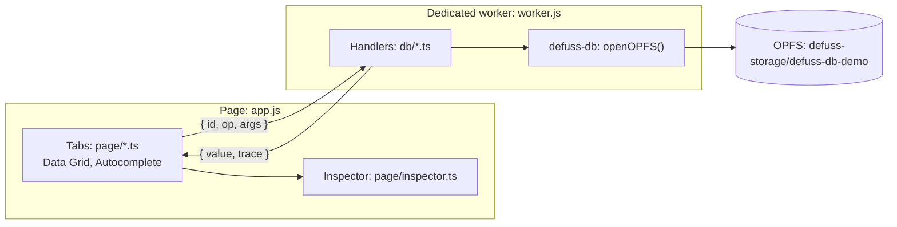

# Ledger playground

Ledger is the site's interactive playground. It shows defuss-shadcn 0.9.14's Data Grid, Autocomplete and Property Grid over a real defuss-db database. The database runs in a dedicated module worker and stores its files in the browser's origin private file system (OPFS). The first visit seeds the store; later visits reopen the same files. `scripts/demo-build.mjs` builds these sources into `docs/demo/`, and the landing page embeds that folder in an iframe.

The layout follows the Ledger demo of defuss-dataview: a tab bar of Big Data components on the left, and an inspector on the right. The inspector shows the store, the active tab's figures and example queries, the TypeScript call behind the current view with its measured time and access plan, and the selected record.

## Why a database worker instead of arrays in the page

The defuss-dataview Ledger generates its records in the page on every visit and queries arrays. That design cannot show what defuss-db adds: data that survives a reload, transactions over several collections, snapshots, document history and persisted search indexes. This playground therefore keeps every tab's data in one defuss-db store, and the grid holds only the pages it has loaded.

The database must run in a dedicated worker, because OPFS sync access handles exist only there. The page reaches it through one message protocol, `shared/protocol.ts`: `{ id, op, args }` in, `{ id, ok, value }` or `{ id, ok: false, error, code }` out, plus progress events while seeding. Every database result carries a trace: the TypeScript that ran with its real arguments (`shared/code.ts` renders the values), the milliseconds measured in the worker, and `explain().access` where the call has one.



## Tabs and the calls behind them

| Tab | Use case | defuss-db calls |
| --- | --- | --- |
| Orders (Grid) | 100,000 sales orders: sort, filter, page and edit | `query({ filters, sorters, offset, limit })`, `pageByIndex('byRegionDate', { prefix, after })`, `count()`, `explain()`, `db.transaction()` for a status edit and its audit line |
| Reports (Compute) | Revenue, refunds and VAT over all orders | `prepareAggregate()`, `prepareSelect()`, `prepareView()` built with `orders.q`, then `evaluate()` |
| Price history (History) | A price list with effective dates and a later correction | `ensureCollection('prices', { $trackHistory: true })`, `at(date, { $asOfRevision }).find()`, `history(id)`, `audit(id)`, `update(id, patch, { $historic, $until })` |
| Accounts (Transactions) | Treasury transfers that must keep the total | `db.transaction()` over `accounts` and `transfers`, `aggregate()` with `sumBigInt`, `db.snapshot()`, `pageByIndex('byTime')` |
| Search (Autocomplete) | Full-text search over 5,000 catalog items | `createSearchIndex({ kind: 'lexical' })`, `search()` with prefix, fuzzy and filters applied before ranking |

`shared/reports.ts` holds each report's plan and the code text the inspector shows, side by side, so a change to one is reviewed with the other.

## Paging the Orders grid

The Data Grid runs its queries over the records it holds. With `data-paging="infinite"` and a `load(offset, size)` loader it asks for more records as the user scrolls. `page/orders.ts` follows the grid's store: when the filters or the sort change, it gives the grid a new loader for that query, so the worker answers the query and the grid shows only what came back.

A query with the shape of the ordered index `byRegionDate` (region, newest first) pages by keyset cursor through `pageByIndex()`. Any other query pages by offset through `query()`, and the planner still uses an index where one fits. The exact total comes from one `count()` per query, after the first page.

VERIFIED (defuss-shadcn 0.9.14, `dist/components/data-grid/data-grid.js`): a load that resolves after `setSource()` appends its rows to the new source, and a pending load stops the new source's first load. The tab therefore waits for the pending load before it calls `setSource()`.

VERIFIED (same file): this release's Data Grid has no cell editor API. The editable status column is a native `<select>` in a custom cell; the grid leaves clicks and keys in such controls to them.

## Seeding, reopening and reset

`db/store.ts` opens the store and reads a `meta` record that the seed writes last. When the record is there with the current seed version, the store reopens as it is. Otherwise the worker deletes the namespace's files, seeds them and reopens them. A tab closed during seeding leaves no meta record, so the next visit starts from empty files.

The seed opens the store with automatic compaction off. VERIFIED (Chromium probes, 2026-11-20): with compaction on, two bound compactions blocked a 100,000-order load for 6 s and 22 s, although the finished file held 4 % garbage. Packing the file after the load took 35 to 62 s, so the seed leaves the file as written.

Orders are generated in date order with zero-padded string IDs (`SO-000001`). VERIFIED (same probes): numeric IDs are stored as lexicographic tokens, so ascending numbers scatter their inserts across the key space; padded strings append to its end.

Reset data closes the store, deletes `defuss-storage/defuss-db-demo` from OPFS and seeds again. VERIFIED (defuss-storage 0.4.1, `dist/opfs.mjs`): the storage keeps a namespace's files in that directory.

## Measured in Chromium

VERIFIED: `scripts/e2e-demo.mjs`, 2026-11-20, Chromium 153.0.8010.12 headless on an Apple M5 Max, run while another session used the CPU. A range spans the two or three runs that measured it; the worker measures around its database calls. The page waits for each query's count before it measures the next query.

| Operation | Time |
| --- | ---: |
| First visit: seed 100,000 orders, 5,000 catalog items, prices and accounts | 1.8-2.2 s |
| Later visit: `openOPFS()` of the seeded store | 7.4-8.6 ms |
| Reset data, from the click to the reloaded page | 1.9-2.0 s |
| First `count()` of all orders after seeding, next to the start-up counts | 4.1-4.8 s |
| `query()` sorted by amount: a scan of 100,000 orders | 481-538 ms |
| `pageByIndex()`: 100 EU orders, newest first, first and next page | 51-87 ms |
| `query()` with a customer filter: 2,310 orders scanned for 100 matches | 15-22 ms |
| The same filter on top of EU, newest first: 2,301 orders read through the index | 1.2-1.3 s |
| `count()` of one region or one filter | 458-628 ms |
| A report's `evaluate()`: a scan of 100,000 orders | 456-560 ms |
| The same report on its third run, from the result cache | 0.9-1.1 ms |
| A status edit, a transfer or a price correction: one `db.transaction()` or `update()` | 5-10 ms |
| 25 transfers in sequence | 146-172 ms |
| First search of a visit, which rebuilds the engine from persisted inputs | 236-290 ms |
| Later searches | 7-56 ms |

The store takes 113-115 MiB of OPFS after seeding (`db.stats().committedBytes`).

The seeded file is not compacted, and the figures above are for that file. A compacted file is faster for reads through the ordered index, but compacting costs more than the whole seed. VERIFIED (Chromium probe, 2026-11-20, same machine, three runs each on the seeded store):

| Operation | Seeded file | After `db.compact({ mode: 'exclusive' })` |
| --- | ---: | ---: |
| The compaction itself | | 38.5 s |
| EU and customer filter, newest first: 2,301 orders read through `byRegionDate` | 1.1-1.5 s | 0.5-0.9 s |
| Customer filter alone: 2,310 orders scanned | 13 ms | 17-18 ms |
| `countByIndex('byRegionDate', { prefix: ['EU'] })`: 25,093 pointers | 8.8 s | 0.43 s |
| Committed bytes | 118.6 MB | 112.6 MB |

After compaction, a document read through the index still costs 30 to 50 times as much as one read in a scan. The Orders tab therefore counts with `count()`. The planner still reads through the index when a region filter comes with other filters; the inspector's access line names that path.

## Operations

```sh
make build                     # dist/: the worker bundles the built package
node scripts/demo-build.mjs    # website/demo/ → docs/demo/
node scripts/e2e-demo.mjs      # Chromium, desktop and phone; results in output/demo/
```

The build bundles `app.ts` and `theme.ts` for the page and `worker.ts` for the worker with esbuild. It copies `index.html`, `app.css`, defuss-shadcn's `core.min.css`, `all.min.css` and `all.min.js` with its licence and notice, and the site's fonts with their licences. `vendor/SOURCES.json` records the package version and its integrity from `bun.lock`. The worker's Brotli codecs load only for archives; the demo never calls them, so the browser does not request `modules/`. `docs/demo/` holds 3.9 MB in total.

The page works at `demo/` under any static server and inside an iframe of the same origin. Two tabs can share the store. VERIFIED (Chromium probe, 2026-11-20): a transfer made in one tab appeared in the other tab's next read.

## Security

The page declares `script-src 'self' 'wasm-unsafe-eval'` in a CSP meta tag and loads nothing from another origin. The theme script is a file, not inline code. Text from the database reaches the page through `textContent` or as plain JSON for the Property Grid; no database value becomes HTML.

## Privacy

Every record comes from a fixed seed in `data.ts`; customers carry the names of computing pioneers, and the catalog uses invented brand names. The data stays in the visitor's browser, in the OPFS of the site's origin, and the page sends no request with it. Reset data deletes it. The page reads `defuss-db-theme` from local storage to match the site's theme, and the Data Grid keeps each grid's sort and filters in session storage.
